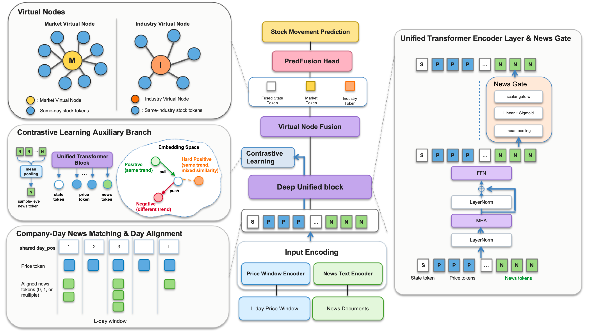

# MTVC

Code for the paper **MTVC: Multimodal Transformer with Virtual Nodes and Contrastive Learning for Stock Movement Prediction**.

## Model architecture



*Figure 2 from the paper: Unified Price-News Modeling with Virtual Nodes and Contrastive Learning.*

## Pretrained checkpoints

Download [MTVC_checkpoints.tar.gz from Google Drive](https://drive.google.com/file/d/1ZrCVBTbSoMKLMvESaHD8yKlaTX0Kf7dM/view?usp=sharing) (5.46 GiB). Keep the extracted checkpoints separate from the code repository and use `--checkpoint-root` to select their location.

Place the downloaded archive next to the repository, then extract it from the repository root:

```bash
tar -xzf ../MTVC_checkpoints.tar.gz -C ..
```

This creates `../MTVC_checkpoints/`, the default checkpoint location.

SHA256 of the checkpoint archive:

```text
01d33cd92d359d15a05b004c43809984fff5a8744245226c24d4f17814a33ec2
```

## Installation

Use Python 3.10 and install the pinned dependencies:

```bash
python -m venv .venv
source .venv/bin/activate
pip install -r requirements.txt
```

`requests.txt` is an alias for the same environment specification. The PyTorch build targets CUDA 12.4; select the device explicitly when running evaluation.

## Repository layout

```text
code/mtvc/             Model, data loading and training
baselines/             PEN, StockNet and price-only models
configs/               Training and checkpoint evaluation recipes
scripts/               Training, evaluation and prediction export
return_rate_analysis/  Portfolio metrics and equity curves
phase_periodicity/     Phase analysis tools
data_preparation/      Data preparation tools
dict/                  Token vocabularies
assets/                Required training assets
```

Place the datasets under `data/CSMD50`, `data/CSMD300` and `data/massive_data`, or pass `--data-root`. Keep checkpoint files in a separate sibling directory `../MTVC_checkpoints`.

## Checkpoint evaluation

```bash
python scripts/reproduce.py evaluate --dataset csmd50 --case full_casel6 --seed 42   --checkpoint-root ../MTVC_checkpoints --device cuda:0   --acc-tolerance 0.0001 --mcc-tolerance 0.001   --output results/evaluation/csmd50_full_s42.json

python scripts/reproduce.py evaluate-all --all-datasets --tag best   --checkpoint-root ../MTVC_checkpoints --device cuda:0   --acc-tolerance 0.0001 --mcc-tolerance 0.001   --output results/evaluation
```

Accuracy tolerances use probability units: 0.0001 equals 0.01 percentage points. Exact matches and matches within explicitly supplied tolerances are reported separately. Evaluation loads checkpoint-specific recipes from the collection when present, otherwise from `configs/release_checkpoint_recipes.json`. Training uses `configs/paper_recipes.json`.

## Training

```bash
python scripts/reproduce.py train --dataset csmd50 --case full_casel6 --seed 42   --device cuda:0 --output results/training/csmd50_full_s42
```

Model initialization follows the fixed default construction order. See `docs/REPRODUCIBILITY.md` for checkpoint loading and environment considerations.

## Baselines

```bash
python scripts/evaluate_baseline.py --method stocknet --dataset csmd300 --seed 42   --checkpoint-root ../contrast_exp_novol_s42_46/checkpoints/novol_accmcc_s42_46   --device cuda:0 --output results/baselines/stocknet_csmd300_s42.json
```

See `baselines/README.md` for supported methods, sampling-state requirements and dated prediction export.

## Portfolio metrics and figures

```bash
python scripts/export_predictions.py --dataset csmd50 --case full_casel6 --seed 42   --checkpoint-root ../MTVC_checkpoints --output results/portfolio_inputs/csmd50_mtvc_s42.csv

python return_rate_analysis/scripts/reproduce_portfolios.py   --manifest results/portfolio_inputs/manifest.json --output results/portfolios
```

See `return_rate_analysis/README.md` for the manifest format, baseline exports, calendar alignment and ARR/SR definitions. Reports, logs and generated figures are runtime outputs and are excluded from this source distribution.
